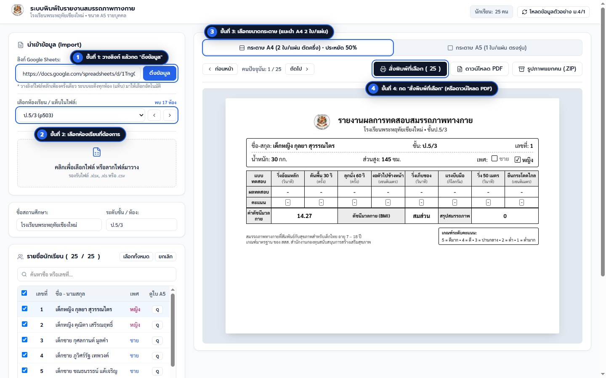

# ระบบพิมพ์ใบรายงานสมรรถภาพทางกาย (ขนาด A5 รายบุคคล)
**โรงเรียนพระหฤทัยเชียงใหม่**

เว็บแอปพลิเคชันสำหรับดึงข้อมูลผลการทดสอบสมรรถภาพทางกายและดัชนีมวลกาย (BMI) จาก Google Sheets หรือไฟล์ Excel/CSV เพื่อนำมาพิมพ์เป็นใบรายงานผลขนาด A5 รายบุคคล แจกให้นักเรียนได้อย่างสะดวกรวดเร็ว

**เข้าใช้งานออนไลน์ได้ทันทีที่**: [https://bmiprint.vercel.app/](https://bmiprint.vercel.app/)  
*(สำรองผ่าน GitHub Pages: [https://vector033.github.io/BMI_print/](https://vector033.github.io/BMI_print/))*

---

## 4 ขั้นตอนการใช้งานง่ายๆ



1. **ขั้นที่ 1: วางลิงก์ แล้วกด "ดึงข้อมูล"**
   * วางลิงก์ Google Sheets ไฟล์หลัก **เพียงครั้งเดียว** แล้วกดปุ่ม **"ดึงข้อมูล"**
   * หรือหากมีไฟล์ Excel (`.xlsx`, `.xls`) หรือ `.csv` สามารถลากไฟล์มาวางในกล่องด้านล่างได้ทันที
2. **ขั้นที่ 2: เลือกห้องเรียนที่ต้องการ**
   * ระบบจะดึงรายชื่อทุกแท็บ/ห้องในไฟล์มาแสดงในช่อง **Dropdown เลือกห้องเรียน** อัตโนมัติ (รองรับทั้ง ป., ม., อ.)
   * สามารถเลือกสลับห้องจาก Dropdown หรือกดปุ่ม `<` `>` เพื่อเปลี่ยนห้องได้ทันทีโดยไม่ต้องก๊อปลิงก์ใหม่
3. **ขั้นที่ 3: เลือกขนาดกระดาษที่ต้องการ**
   * แนะนำเลือก **"กระดาษ A4 (2 ใบ/แผ่น ตัดครึ่ง) • ประหยัด 50%"** จะจัดพิมพ์ 2 คนต่อ 1 แผ่น A4 มีเส้นประแบ่งครึ่งสำหรับตัดแจก
   * หรือเลือก **"กระดาษ A5 (1 ใบ/แผ่น ตรงรุ่น)"** หากใช้กระดาษ A5 สำเร็จรูป
4. **ขั้นที่ 4: กด "สั่งพิมพ์ที่เลือก"**
   * กดปุ่ม **"สั่งพิมพ์ที่เลือก"** เพื่อเปิดหน้าต่างพิมพ์ของเบราว์เซอร์แล้วสั่งพิมพ์ได้ทันที (ไม่มีหน้าว่างคั่น ไม่ตกขอบ)
   * หรือกดปุ่ม **"ดาวน์โหลด PDF"** เพื่อรวมเล่มเป็นไฟล์ PDF หรือ **"รูปภาพแยกคน (.ZIP)"** เพื่อส่งให้ผู้ปกครองหรือนักเรียนรายบุคคล

---

## ฟังก์ชันเด่นของระบบ

* **วางลิงก์ครั้งเดียวสลับได้ทุกห้อง**: ดึงรายชื่อแท็บทั้งหมดจาก Google Sheets และ Excel หลายชีตมาเป็น Dropdown ให้อัตโนมัติ
* **รองรับทุกระดับชั้น**: ตรวจจับระดับชั้น ประถม (`ป.`), มัธยม (`ม.`), อนุบาล (`อ.`) และคำนำหน้าชื่ออัตโนมัติ รวมถึงซ่อน `-` กรณีนักเรียนไม่มีนามสกุล
* **จัดพิมพ์ประหยัดกระดาษ**: พิมพ์ 2 ใบต่อ 1 แผ่น A4 พร้อมเส้นประตัดกึ่งกลางพอดี A5
* **เกณฑ์มาตรฐาน สสส.**: แสดงค่า BMI แปลผลสมรรถภาพ และระดับคะแนน 1-5 พร้อมตารางเกณฑ์ระบุชัดเจนทุกใบ
* **ส่งออกได้หลากหลาย**: ทั้งพิมพ์ออกเครื่องพิมพ์โดยตรง, บันทึกเป็น PDF รวมเล่ม, และส่งออกไฟล์รูปภาพ PNG แยกคนแบบบีบอัด (.ZIP)

---

## สำหรับรันในเครื่องแบบ Local (ออฟไลน์)
ดับเบิ้ลคลิกไฟล์ `start.bat` หรือรันคำสั่ง:
```bash
python server.py
```
แล้วเปิดเบราว์เซอร์ไปที่ `http://localhost:8000/`
